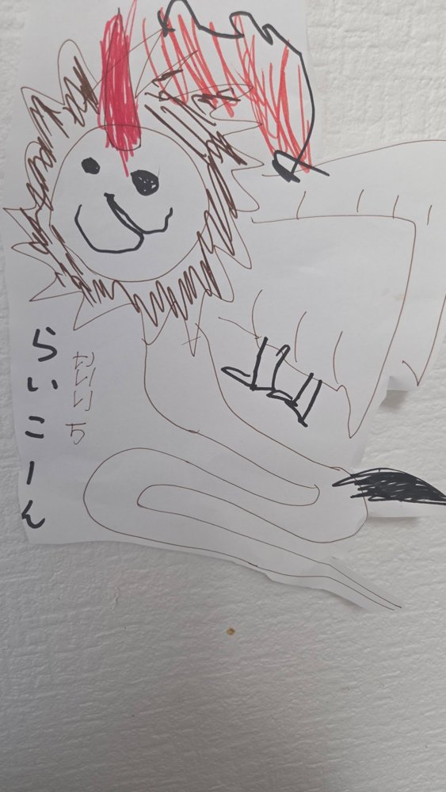

# らいこーん そらのおさんぽ

子どもの絵「らいこーん」を立体（3D）にして、街の上を飛びまわれるブラウザゲームです。
`index.html` をブラウザで開くだけで遊べます（three.js を CDN から読み込むのでインターネット接続が必要です）。
ローカルで開く場合は `python3 -m http.server` などで配信して `http://localhost:8000/` を開いてください。

## らいこーんの立体デザイン（原画からの解釈）

| 原画の特徴 | 3D での表現 |
|---|---|
| まるい顔・黒い目・にっこり口 | 丸い頭、大きな黒い瞳（ハイライト付き）、U字の笑顔、ほっぺの赤み |
| 顔のまわりの茶色いギザギザ | 3層のトゲトゲたてがみ（4色の茶色、毛並みテクスチャ） |
| 頭の上の赤いツノ | らせん溝のついた赤いツノ（クリアコートでツヤ） |
| 右上の赤いぐるぐる | 頭から背中へ流れる「赤い炎のたてがみ」。飛ぶ速さで揺れる |
| 大きな羽（線＝羽根） | 初列・次列・雨覆いの羽根を重ねた白い翼。はばたき・高速時は後退翼 |
| 黒い3本線 | 前脚の黒いしま模様 |
| 長いしっぽと黒い先 | S字に曲がる長いしっぽ＋黒いふさ |
| 体 | ライオンらしい金色がかったクリーム色の毛並み（シーン付き物理マテリアル） |

## ステージ

1. **東京都港区・東京タワー周辺** — 東京タワー（333m、赤白の塗り分け・トラス構造）、増上寺（大殿・三解脱門）、芝公園、首都高速（都心環状線・1号線・3号線・2号線の高架）、浜松町駅と JR の電車、麻布台ヒルズ・虎ノ門ヒルズ・六本木ヒルズなどの超高層、汐留、浜離宮、東京湾、レインボーブリッジ、お台場
2. **千葉市稲毛区・穴川周辺（国土地理院データで再現）** — 穴川駅を中心に、**実際の地形・航空写真・建物の形**から作ったステージです。
   - 地面：国土地理院の航空写真（全国最新写真・シームレス）。中心3.5km四方は約1m/画素、まわり12km四方は約4m/画素
   - 地形：数値標高モデル（DEM5A/DEM10B）による本当の高低差（谷津の低地と台地。標高0.7〜30m）
   - 建物：地理院地図Vectorの建物外形 約2万3千棟をそのまま立体化。屋根は航空写真で色づけし、長方形の戸建ては切妻屋根に（高さのデータはないので、建物の種類と大きさから推定）
   - 木：航空写真の樹冠（濃い緑で凹凸のある部分）だけに木を配置
   - 鉄道・道路：千葉都市モノレール2号線（駅位置も実データ）、JR総武線・京成千葉線、京葉道路（穴川IC）などの実際の線形に電車・車を走らせています
   - 遠くは航空写真をもとに市街地を配置。南西には東京湾、西に幕張のビル群
   - 出典：国土地理院（地理院タイル［全国最新写真（シームレス）］・数値標高モデル・地理院地図Vector）を加工して作成
   - データの作り直し：`tools/anagawa/` のスクリプト（`download.py` → `process.py`）

東京タワー周辺は、主要な道路・施設の位置関係を参考にして街をプログラムで生成しています（建物の配置そのものは実際とは異なります）。穴川周辺は上のとおり国土地理院の実データです（Google マップのデータは利用規約上ダウンロードして使えないため、公的な地理院データを使っています）。

## そうさ

| 動き | キーボード | スマホ |
|---|---|---|
| 左・右に曲がる | ← → / A D | ◀ ▶ |
| 上がる・下がる | ↑ ↓ / W S | ▲ ▼ |
| スピードアップ | Space / Shift | はやく |
| スピードダウン | Z / Ctrl | ゆっくり |
| カメラきりかえ | C / 1〜6 | 🎥 |
| ホバリング（その場でふわふわ） | H | ⏸ |
| まわして見る | マウスでドラッグ | 1本指でドラッグ |
| ズーム | ホイール | ピンチ |
| 視点をもとにもどす | R | 🎥 |
| タイトルへ | Esc | ⌂ |

カメラは「うしろ・ななめまえ・まえ・よこ・うえ・ぐるぐる（自動で一周）」の6種類。ホバリング中にドラッグすると、止まったらいこーんをじっくり観察できます。タイトル画面でもドラッグでらいこーんを回せます。

ふわふわ感：はばたきに合わせた上下のゆれ、旋回時のバンク、慣性のある上昇下降。
スピード感：速度に応じて視野角（FOV）が広がり、風の線・集中線・風切り音が強くなります（最高 約540km/h）。
